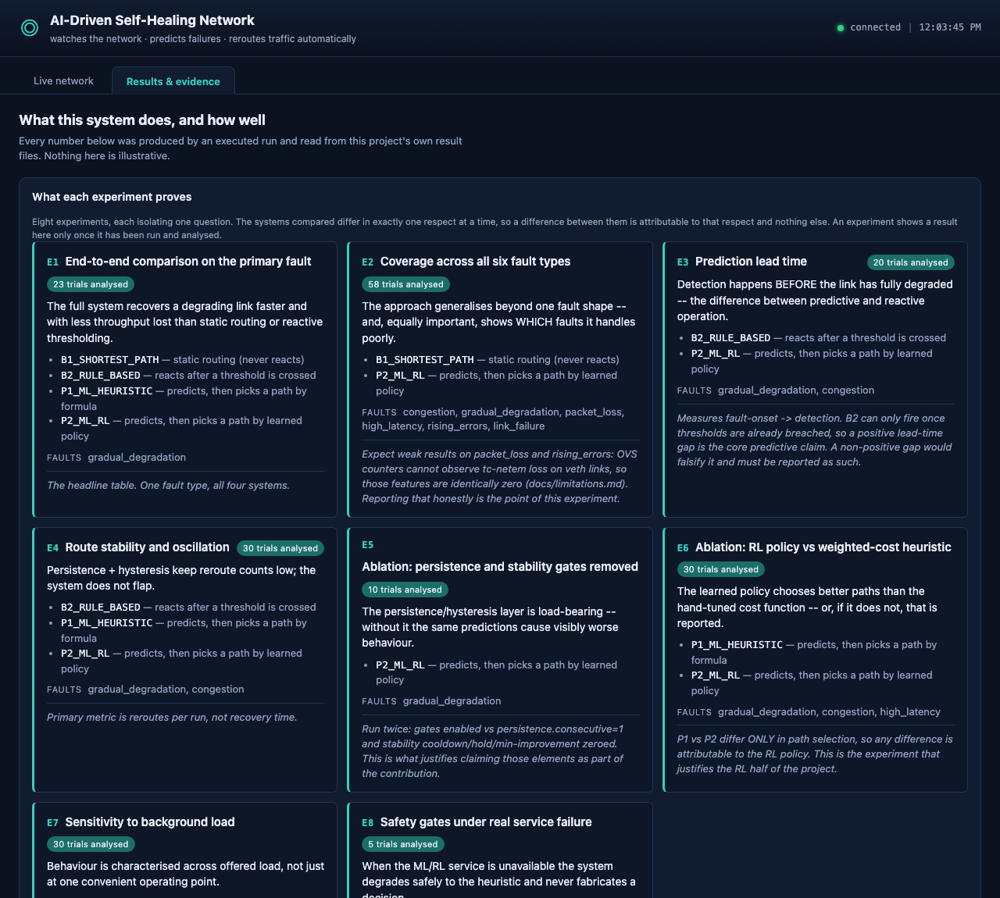
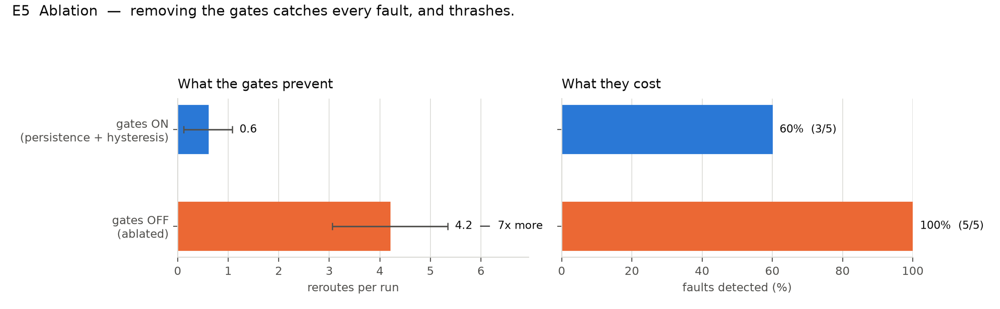

# AI-Driven Self-Healing Software-Defined Network

[](https://github.com/aditicodes7/ai-self-healing-sdn/actions/workflows/tests.yml)

A closed-loop self-healing SDN: an ML model predicts link degradation ahead
of time, a trained RL policy selects a remediation path, the controller
installs OpenFlow rules automatically, recovery is measured and verified,
and the whole loop is shown live on a dashboard.



*All eight experiments, their claims and their measured results, on one page.*

## Quick start

```bash
# Run the test suite — no VM needed
venv-ml/bin/python -m pytest tests/unit -q           # 284 tests

# Verify every published number re-derives from its artefact
python3 scripts/verify_reproducibility.py

# Browse the results dashboard — no VM needed
./show-dashboard.sh                                  # -> http://127.0.0.1:8000

# The live demo — inside the Linux VM, needs Mininet
sudo python3 demo/run_live_demo.py --fault-after 120 --manual
```

The demo settles for 120 s and then waits for you to press Enter. The damaged
link turns orange at ~13 s, the traffic path visibly moves, and the repair is
verified at ~22 s.

**Current status:** see [PROJECT_STATE.md](PROJECT_STATE.md) for the
authoritative phase-by-phase status, environment, decisions, and test
results. This README gives orientation; PROJECT_STATE.md is never stale by
more than one commit.

Architecture: [docs/architecture.md](docs/architecture.md) ·
Known limitations: [docs/limitations.md](docs/limitations.md) ·
Design rationale: [docs/decisions.md](docs/decisions.md)

## Measured results

All figures below come from executed runs on an emulated Mininet network
(6 switches, 8 links, 5-10 Mbit), read from `results/tables/`. Faults are
real `tc netem` impairments, not simulated numbers.

**Coverage across six fault types** (E2, 60 trials, the full system):

| fault | detected | recovery |
|---|---|---|
| link failure (cable cut) | **100%** (5/5) | 20 s |
| gradual degradation | **100%** (4/4) | 39 s |
| congestion | 80% (4/5) | 70 s |
| high latency | 60% (3/5) | 47 s |
| packet loss | 20% (1/5) | 75 s |
| rising errors | **0%** (0/5) | never detected |

Static-routing control: **0 detections in 29 trials**, as an inert baseline
should be. The two bottom rows are a predicted result, not a surprise: Open
vSwitch cannot observe `tc netem` loss or corruption on veth links, so those
features are identically zero and the model has nothing to learn from. E2
exists to measure that rather than assert it.

## The clearest result: are the safety gates worth anything?



Same fault, same topology, same predictions. The only change is acting on one
prediction instead of three consecutive ones, with the cooldown, hold-down and
minimum-improvement thresholds removed.

**Removing them multiplies rerouting sevenfold** — 0.6 to 4.2 per run, and the
two distributions do not overlap: every gated trial rerouted at most once,
every ablated trial at least three times.

The right-hand panel is the honest other half. Without the gates the system
detects *more* (5/5 against 3/5). That is the trade they exist to make, not a
failure of them: requiring three consecutive predictions means some genuine
faults are missed, and in exchange the system does not act on every
fluctuation of a classifier whose precision is 0.112.

## Two hypotheses this project's own experiments falsified

Reported here rather than buried, because the evidence is the point.

**"Prediction detects earlier than a threshold."** It does not. On
in-fault detections the reactive baseline averaged **59.7 s** against the
full system's **72.9 s** (E3). What the full system is better at is
*coverage* — it caught **70%** of faults while they were still happening
against the baseline's **40%**, and every one of its detections landed
during the fault, where 6 of the baseline's 10 were reactions to the fault
being removed. That is a real advantage, but it is a different claim, and
substituting it silently would be a retrofitted hypothesis.

**"The learned routing policy beats the hand-tuned formula."**
**Retracted, then answered on narrower terms.** The first E6 run was invalid
— the policy declined to act in 7 of 11 selections and the heuristic decided
instead, so the experiment largely compared the formula against itself. After
fixing that, an offline replay of a recorded decision contradicted what the
live system did, which meant the run could not be interpreted at all. The
system now records the exact inputs behind every routing decision
(`route_changes.decision_inputs_json`), and E6 was re-run against that
record: across **44** decisions the policy disagreed with the formula 33
times, choosing the **higher-capacity path 24 times against 3 narrower**. The
control arm — the formula replayed against its own inputs — agreed **31 of
31** times, which is what makes the replay trustworthy at all.

What stays unproven is that this converts into better end-to-end throughput.
On this topology the shortest path is also the narrowest, so any reroute
gains capacity and the metric is confounded. The claim the evidence supports
is about decision quality, not outcome.

Six separate instances of one recurring root cause — a measurement taken
under conditions that did not match what was claimed — were found and
documented during evaluation. They are written up in
[docs/limitations.md](docs/limitations.md) as a single pattern rather than
six separate mishaps.

## Data honesty

Every number in this repository's docs, figures, and papers traces to a
JSON/CSV artefact under `results/` produced by an executed run. If a
measurement has not been taken yet, the docs say `NOT YET MEASURED` — never
a placeholder value. Every dataset is labelled `data_source:
emulated_mininet` or `data_source: synthetic_simulator`; neither is ever
described as real-world traffic. See [docs/limitations.md](docs/limitations.md)
for every place emulation stands in for something that couldn't be measured
directly, and why.

## Repository layout

Two Python interpreters are used deliberately and never import each other:

- `venv-ctrl` (Python 3.9): the Ryu/os-ken controller — needs a real Linux
  kernel host (Mininet + Open vSwitch) to drive the data plane.
- `venv-ml` (Python 3.11): dataset generation, ML training, RL training,
  the inference service, the FastAPI backend, and the test suite.

They communicate over localhost HTTP and a shared SQLite file
(`database/network.db`, WAL mode). `common/` is pure Python + numpy so both
venvs import it unchanged.

See the top of [PROJECT_STATE.md](PROJECT_STATE.md) for the full directory
tree as it exists today (it grows one phase at a time; this README does not
duplicate a tree that will immediately go stale).

## Setup

```
make setup-ml      # Python 3.11 venv: ML/RL/backend/tests
make setup-ctrl    # Python 3.9 venv: Ryu controller (Linux host only)
make test          # runs tests/unit + tests/integration under venv-ml
```

Mininet/OVS require a real Linux kernel and root. If your development
machine is not Linux, run the data-plane phases inside a Linux VM (Ubuntu
22.04 LTS, 4GB RAM / 4 vCPU is enough) — see PROJECT_STATE.md's Environment
section for the specific setup used on this project.

## Documentation

| document | what it is |
|---|---|
| [`docs/architecture.md`](docs/architecture.md) | how the system is put together |
| [`docs/limitations.md`](docs/limitations.md) | every place emulation stands in for something, and why — including seven measurement-validity failures found during evaluation |
| [`docs/decisions.md`](docs/decisions.md) | design rationale, dated |

## Reproducing the results

Every number in this repository traces to a JSON artefact under
`results/tables/` produced by an executed run. Discarded runs are **not
deleted** — they remain in `results/experiments.db` and are listed with the
reason in [`results/invalidated_runs.json`](results/invalidated_runs.json),
which the analyser applies by default.

```bash
venv-ml/bin/python experiments/analyze.py        # re-derive every table
venv-ml/bin/python experiments/make_figures.py   # regenerate every figure
python3 scripts/verify_reproducibility.py        # check the docs match the data
```

That last command exists because several documents quote numbers transcribed
by hand, and a transcription error reads as a perfectly plausible number. It
caught one: every document said 181 trials when the true total was 206.

## Licence

No licence is currently specified. All rights reserved — please get in touch
before reusing any part of this.
